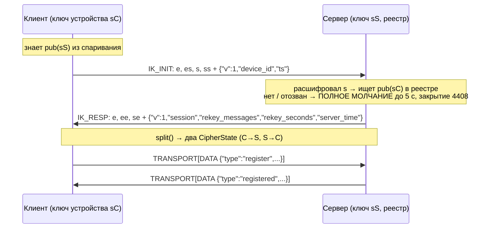
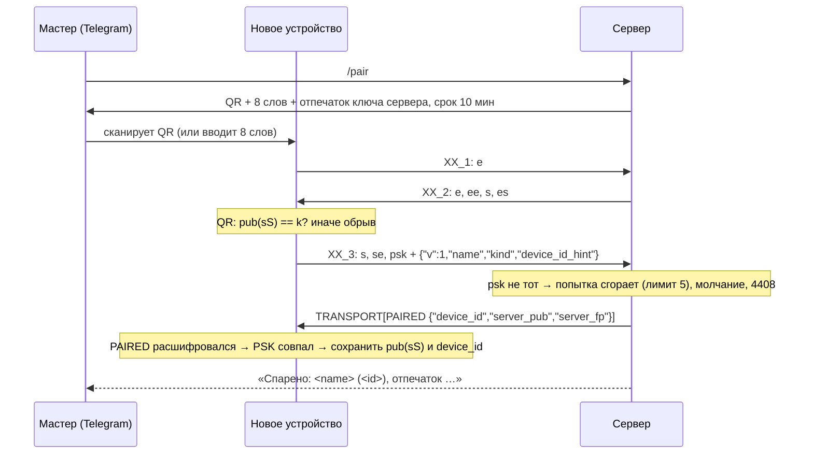

# Защищённый канал Сакуры (securechannel/1) — спецификация

Статус: **зафиксировано для независимой реализации клиентом** (desktop/core).
Всё, что помечено «ФИКС», меняется только новой версией протокола.
Модель угроз — [THREAT_MODEL.md](THREAT_MODEL.md), ключи — [KEYS.md](KEYS.md).

## 0. Коротко

- Поверх существующего WebSocket (тот же порт 8765, тот же `ws://`) —
  протокол **Noise**: домен и сертификаты не нужны, доверие — статический
  ключ сервера, который клиент получает при спаривании.
- Сеанс: `Noise_IK_25519_ChaChaPoly_BLAKE2s` (клиент заранее знает ключ
  сервера, 1 круг рукопожатия).
- Спаривание нового устройства: `Noise_XXpsk3_25519_ChaChaPoly_BLAKE2s` с
  одноразовым PSK из Telegram (`/pair`: QR и 8 слов).
- После рукопожатия **весь протокол приложения не меняется**: те же JSON
  (`register`, `voice_command`, `reply`, …), только внутри зашифрованных кадров.
- Криптопримитивы — только из проверенных библиотек (PyCA `cryptography`,
  `hashlib`); на сервере рукопожатие и шифрование выполняет `noiseprotocol`
  (MIT), учебная реализация `securechannel/noise/` сверяется с ней и с
  официальными тестовыми векторами.

## 1. Режимы сервера (`SECURE_CHANNEL`)

| режим | текстовые JSON с `token` (старые клиенты) | бинарные кадры Noise |
|---|---|---|
| `off` (по умолчанию до выката) | да | нет — закрытие 4400 |
| `optional` | да | да |
| `required` | нет — закрытие **4412** | да |

Тип соединения определяется по **первому** WebSocket-сообщению: текстовое —
старый протокол, бинарное с магией `SK` — Noise. Смена типа внутри
соединения запрещена (4400).

## 2. Кадр (ФИКС)

Одно бинарное WebSocket-сообщение = ровно один кадр.

```
 0      2      3      4            8
 +------+------+------+------------+-----------------+
 | "SK" | ver  | type | length u32 |  body (length)  |
 +------+------+------+------------+-----------------+
   0x53 0x4B   0x01         big-endian
```

| поле | значение |
|---|---|
| magic | `0x53 0x4B` («SK») |
| ver | `0x01` |
| type | см. таблицу |
| length | длина body, **должна совпадать** с реальной; ≤ 65535 |

| type | имя | направление | body |
|---|---|---|---|
| `0x01` | `IK_INIT` | C→S | Noise IK, сообщение 1 |
| `0x02` | `IK_RESP` | S→C | Noise IK, сообщение 2 |
| `0x11` | `XX_1` | C→S | Noise XXpsk3, сообщение 1 |
| `0x12` | `XX_2` | S→C | сообщение 2 |
| `0x13` | `XX_3` | C→S | сообщение 3 |
| `0x20` | `TRANSPORT` | ↔ | шифртекст транспортного сообщения Noise |

Любое нарушение формата → закрытие **4400** (после рукопожатия) или молчание
до таймаута (во время рукопожатия, см. §6).

## 3. Рукопожатия

### 3.1 Пролог (ФИКС)

```
prologue = b"sakura-securechannel/1\x00" + b"session"   # IK
prologue = b"sakura-securechannel/1\x00" + b"pair"      # XXpsk3
```

Пролог связывает рукопожатие с версией и назначением: сообщение XX нельзя
выдать за IK и наоборот (хеш рукопожатия разойдётся).

### 3.2 Сеанс: IK

```
IK:
  <- s                      (ключ сервера известен заранее)
  ...
  -> e, es, s, ss           IK_INIT  payload: идентификация
  <- e, ee, se              IK_RESP  payload: параметры сеанса
```



**Нюанс IK (ФИКС):** первое сообщение IK зашифровано только на ключах
`es`, `ss` и **подвержено повтору**: атакующий может переслать записанный
`IK_INIT` позже, сервер ответит `IK_RESP`. Без эфемерного ключа клиента
атакующий не выведет ключи сеанса, поэтому повтор бесполезен — НО только
если в payload сообщения 1 нет ничего, что сервер исполняет. Поэтому:

- payload `IK_INIT` = **только идентификация**:
  `{"v": 1, "device_id": "<id>", "ts": <unix float>}`;
  `ts` сервер лишь журналирует (разброс часов), решений по нему не принимает;
- любые команды — только транспортными сообщениями после `IK_RESP`.

Payload `IK_RESP`: `{"v": 1, "session": "<16 hex>", "rekey_messages": 10000,
"rekey_seconds": 3600, "server_time": <unix float>}`.

### 3.3 Спаривание: XXpsk3

```
XXpsk3:
  -> e                      XX_1   payload: пусто
  <- e, ee, s, es           XX_2   payload: пусто
  -> s, se, psk             XX_3   payload: {"v":1,"name","kind","device_id_hint"}
```



Почему psk в 3-м сообщении: ключ сервера (`s` в XX_2) ещё не подтверждён PSK.
Клиент **обязан** считать сервер подлинным только после того, как
расшифровал первый транспортный кадр `PAIRED` (он зашифрован ключами, в
которые смешан PSK). При спаривании по QR клиент дополнительно сверяет
`s` из XX_2 с ключом из QR **до** отправки XX_3.

После спаривания соединение **закрывается** (1000); дальше устройство
подключается сеансом IK.

### 3.4 PSK и 8 слов (ФИКС)

- Мастер получает 8 слов из словаря 256 русских слов
  (`securechannel/wordlist_ru.txt`, порядок важен только серверу) —
  64 бита энтропии; одноразово, 10 минут, не больше 5 попыток.
- Нормализация: нижний регистр, `ё → е`, всё, что не буква, — разделитель,
  слова через один пробел.
- `psk = BLAKE2s(b"sakura-pair/1\x00" + normalized_utf8, digest_size=32)`.
- Сервер хранит **только psk** (хеш слов), слов не хранит и не журналирует.
- Клиенту словарь не нужен: он нормализует введённое и считает тот же хеш.

### 3.5 QR (ФИКС)

Текст QR — URI:

```
sakura-pair://1?u=<url сервера>&k=<pub сервера, base64url без =>&w=<8 слов через ->&e=<срок, unix>
```

Пример: `sakura-pair://1?u=ws%3A%2F%2F31.76.80.5%3A8765&k=yDu...&w=лес-кот-мост-...&e=1791900000`.
Клиент сверяет `k` с ключом из XX_2. Отпечаток ключа (для глаз) —
`fingerprint(pub)` (§8) — Telegram показывает его рядом с QR.

## 4. Транспорт

### 4.1 Внутренний заголовок (ФИКС)

Расшифрованный body кадра `TRANSPORT`:

```
 +----------+----------+-------------------+
 | inner u8 | flags u8 | data              |
 +----------+----------+-------------------+
```

| inner | имя | data |
|---|---|---|
| `0x01` | `DATA` | кусок UTF-8 JSON сообщения приложения |
| `0x02` | `REKEY` | пусто; после него отправитель меняет ключ своего направления |
| `0x03` | `CLOSE` | `code u16 BE` + причина UTF-8 |
| `0x04` | `PING` | ≤ 32 байта |
| `0x05` | `PONG` | эхо PING |
| `0x06` | `PAIRED` | UTF-8 JSON `{"device_id","server_pub","server_fp"}` (только после XX) |

`flags`: бит 0 — `MORE` (за этим куском следует продолжение того же
сообщения `DATA`). Остальные биты — 0.

Заголовок внутри шифртекста — тип и флаги защищены AEAD, внешний `type`
кадра всегда `TRANSPORT`.

### 4.2 Фрагментация (ФИКС)

- Сообщение Noise ≤ 65535 байт: тег 16 + заголовок 2 → **кусок ≤ 65517 байт**.
- Сообщение приложения ≤ **2 МиБ** (2 097 152 байта); не больше **64**
  кусков. Превышение → закрытие **4413**.
- Куски одного сообщения идут подряд; между ними могут быть только
  `PING`/`PONG`/`REKEY`.

### 4.3 Счётчики nonce, повтор и перестановка

Каждое направление — свой `CipherState` Noise со своим 64-битным счётчиком
`n` (nonce = 4 нулевых байта ‖ n little-endian). Получатель расшифровывает
строго следующим `n`: повтор, пропуск, перестановка или изменение кадра →
ошибка AEAD → закрытие **4409**, без попыток восстановить.

### 4.4 Rekey (ФИКС)

- Каждое направление независимо. Отправитель после **10 000** транспортных
  сообщений или **3600 с** с прошлого rekey отправляет `REKEY` (на старом
  ключе) и сразу выполняет `REKEY()` Noise для своего исходящего
  `CipherState`: `k = ENCRYPT(k, 2^64−1, ε, 0^32)[:32]`; `n` не сбрасывается.
- Получатель, расшифровав `REKEY`, выполняет `REKEY()` для входящего.
- Значения приходят в `IK_RESP` (`rekey_messages`, `rekey_seconds`); клиент
  использует их же.

### 4.5 Закрытие

Вежливо: `CLOSE(code, reason)` → WebSocket close с тем же кодом. Коды
WebSocket (ФИКС):

| код | имя | когда |
|---|---|---|
| 1000 | normal | конец сеанса, после спаривания |
| 4400 | protocol_error | битый кадр, неверный порядок типов, Noise при `off` |
| 4401 | unauthorized | старый протокол: неверный `token` (как сейчас) |
| 4408 | handshake_failed | **любая** неудача рукопожатия: таймаут, неизвестный/отозванный ключ, битое сообщение, неверный PSK — всегда в момент дедлайна 5 с |
| 4409 | integrity | ошибка расшифровки транспортного кадра (подмена, повтор, перестановка) |
| 4412 | secure_required | текстовый JSON при `SECURE_CHANNEL=required` |
| 4413 | too_large | сообщение > 2 МиБ или > 64 кусков |
| 4429 | rate_limited | превышены лимиты рукопожатий с этого IP |

## 5. Сообщения приложения внутри канала

- Без изменений: `register`, `ping`, `voice_command`, … Поле `token`
  **не нужно** (аутентификация — ключом). Поле `device_id` сервер
  **заменяет** идентификатором из реестра (по ключу Noise); расхождение
  журналируется.
- Новое: `{"type": "secure_server_key", "pub": "<base64url>", "fp": "…",
  "retire_after": <unix>}` — сервер сообщает новый ключ при ротации
  (§8.2); клиент сохраняет его и использует со следующего соединения.

### 5.1 Приватные классы

`chat_*`, `history_*`, `memory_*`, `profile_*`, `secure_*`, `vision_request`,
`computer_step` разрешены только на **secure**-соединении
(`PRIVATE_REQUIRES_SECURE=1`, по умолчанию):

- secure = соединение аутентифицировано Noise, **или** адрес источника
  (берётся из сокета, НЕ из заголовков) — loopback или адрес интерфейса
  самого сервера (клиенты через локальный xray);
- иначе ответ: `{"type": "error", "request_id": …, "code":
  "secure_channel_required", "hint": "подключитесь через защищённый канал
  (Noise) или VPN"}`.

## 6. Лимиты и защита от перебора (ФИКС-значения по умолчанию)

| параметр | значение |
|---|---|
| таймаут рукопожатия | 5 с от первого кадра |
| параллельных рукопожатий с одного IP | 4 |
| параллельных рукопожатий всего | 64 |
| новых рукопожатий с одного IP | 30 в минуту |
| попыток на один код спаривания | 5 |
| срок кода спаривания | 10 минут |

**Неизвестный ключ неотличим по времени:** при любой ошибке рукопожатия
сервер не отвечает и закрывает соединение **ровно в момент дедлайна** (5 с
от первого кадра) кодом 4408 — так же, как при обрыве или битых данных.
Успешный путь отвечает сразу; неуспешные пути по времени одинаковы между
собой.

## 7. Журнал

Строки рукопожатий и соединений содержат `transport=ws|noise` и
`secure=true|false`, `device_id` (из реестра), отпечаток ключа (8 байт) и
код результата. Никогда: ключи, PSK, слова, payload рукопожатия, тексты.

## 8. Ключи, реестр устройств (ФИКС форматов)

### 8.1 Отпечаток

`fingerprint(pub) = BLAKE2s(pub, digest_size=32)[:8]` в hex, группами по 4:
`"3f9a 1c02 77de 0b41"`.

### 8.2 Ключ сервера

Файл `SECURE_DIR/server_keys.json` (права 600; `SECURE_DIR` по умолчанию
`memory/secure`):

```json
{"keys": [
  {"priv": "<base64>", "pub": "<base64>", "created": 1791900000.0, "retire_after": null},
  {"priv": "...", "pub": "...", "created": 1780000000.0, "retire_after": 1792504800.0}
]}
```

Первый — текущий; остальные принимаются до `retire_after` (переход на новый
ключ: сервер пробует расшифровать `IK_INIT` каждым и сообщает клиенту новый
ключ сообщением `secure_server_key`).

### 8.3 Реестр устройств

Файл `SECURE_DIR/devices.json` (права 600):

```json
{"devices": [
  {"id": "mostech", "name": "Ноутбук", "kind": "pc",
   "pub": "<base64>", "fp": "3f9a 1c02 77de 0b41",
   "created": 1791900000.0, "last_seen": 1791903600.0, "revoked": null}
]}
```

`revoked` — время отзыва (`/revoke`); отозванный ключ обрабатывается как
неизвестный (§6).

## 9. Интерфейс пакета `securechannel` (ФИКС имён)

Клиент может реализовать то же сам; имена сервера:

| модуль | имена |
|---|---|
| `securechannel.frames` | `MAGIC`, `VERSION`, `FrameType`, `InnerType`, `FLAG_MORE`, `MAX_BODY`, `MAX_CHUNK`, `MAX_MESSAGE`, `MAX_FRAGMENTS`, `encode_frame(type, body) -> bytes`, `decode_frame(data) -> (type, body)`, `encode_inner(inner, flags, data) -> bytes`, `decode_inner(plain) -> (inner, flags, data)`, `fragment(message) -> list[bytes]`, `Reassembler.feed(flags, data) -> bytes \| None`, `FrameError` |
| `securechannel.handshake` | `Handshake.ik_initiator(s_priv, rs_pub)`, `.ik_responder(s_priv)`, `.xx_initiator(s_priv, psk)`, `.xx_responder(s_priv, psk)`; методы `write(payload) -> bytes`, `read(message) -> bytes`, `complete`, `remote_static`, `handshake_hash`, `split() -> (send, recv)`; `backend="lib"\|"edu"` |
| `securechannel.channel` | `SecureChannel(send, recv, rekey_messages, rekey_seconds)`: `seal(message) -> list[frame]`, `open(frame) -> list[(InnerType, bytes)]`, `ping()`, `close_frame(code, reason)`; `IntegrityError`, `TooLarge` |
| `securechannel.pairing` | `normalize_words(text)`, `words_to_psk(words) -> bytes`, `make_qr_uri(url, server_pub, words, expires)`, `parse_qr_uri(uri) -> dict`, `PairingManager` |
| `securechannel.keys` | `fingerprint(pub) -> str`, `ServerKeys` (`load_or_create`, `rotate`, `current`, `accepted`) |
| `securechannel.registry` | `DeviceRegistry` (`add`, `by_pub`, `get`, `revoke`, `touch`, `list`) |
| `securechannel.server` | `accept(websocket, first_message, …) -> SecureConnection` |

Обёртка `SecureConnection` выглядит для `ws_handler` как обычный
websocket: `recv()`, асинхронная итерация, `send(text)`, `close(code,
reason)`, `remote_address`, плюс `secure`, `transport`, `device_id`.

## 10. Несколько устройств (server/multidevice)

Известные устройства — `DEVICES` в конфиге (по умолчанию `pc, laptop,
mostech, phone`); неизвестный `device_id` не ошибка — показывается как есть.
Права master по-прежнему только из `MASTER_DEVICES`.

### 10.1 Активное устройство

Одно на сервер: `presence_sync.get_active_device()` (старый «последний
ping» в `device_manager` убран, тот делегирует сюда). Правила:

1. Голос (`voice_command`) или текст (`chat_send`) с master-устройства →
   оно активное **сразу**, без порогов.
2. Иначе активно устройство с последним вводом. Клиент присылает в `ping`
   (и `register`) поле `input_idle_s` — секунд с последнего ввода (число ≥ 0).
3. Переключение только если на новом ввод был **≤ 5 с** назад, а на текущем
   **≥ 30 с** назад. Ping без ввода активное не меняет.
4. Нет `input_idle_s` ни у кого → прежняя оценка по `input_score`. Если у
   текущего поля нет, а у другого ввод ≤ 5 с назад, переключаем.
5. Устройство без ping > 120 с или отключившееся выбывает; активным станет
   то, где ввод был позже.

### 10.2 Текущий трек

В `ping` поле `current_track` хранится **по устройствам**
(`device_id → запись`), новая запись заменяет старую целиком. В промпт идёт
трек активного ПК; если он там не играет (`status != "играет"`), берётся самый
свежий играющий трек любого ПК не старше 60 с. Запись старше 60 с не
учитывается.

### 10.3 Запрос `secure_devices`

`{"type": "secure_devices", "request_id": …}` → только master и **только**
secure-соединение (Noise или локальный источник, §5.1); независимо от
`PRIVATE_REQUIRES_SECURE`. Иначе `error` с `code`: `not_master` /
`secure_channel_required`. Ответ:

```json
{"type": "secure_devices", "request_id": "…", "devices": [
  {"device_id": "mostech", "name": "Рабочий ноутбук",
   "fingerprint": "3f9a1c0277de0b41", "paired_at": 1791900000.0,
   "last_seen": 1791903600.0, "online": true, "secure_now": true,
   "revoked": false, "current": true}]}
```

`fingerprint` — первые 16 символов отпечатка (без пробелов); `secure_now` —
сейчас подключено по Noise; `current` — это устройство, приславшее запрос.
Ключи (`pub`) и PSK не отдаются.

### 10.4 Переходы между ПК и настроение

При смене активного устройства сервер сообщает двум устройствам:

- proto 2: `{"type": "presence", "event": "arrival"|"departure",
  "from": "<id>|null", "to": "<id>"}` (arrival — новому, departure — прежнему);
  `mood_update` такие клиенты не получают.
- proto 1: `{"type": "mood_update", "params": {"is_arrival": true}}` /
  `{"is_departure": true}` — только флаг, без параметров настроения.

Общая рассылка настроения (`mood_update` с параметрами орба) выключена
флагом `MOOD_BROADCAST=off` (по умолчанию); код сохранён, `on` возвращает её.
