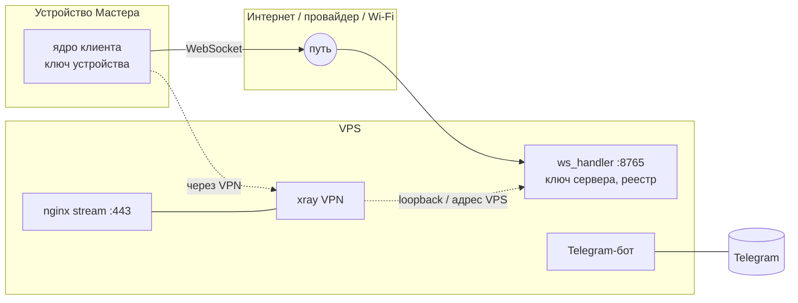

# Модель угроз: канал «клиент Сакуры ↔ сервер»

Учебно-практическая работа по курсу «Криптографические методы защиты
информации». Документ описывает, ЧТО защищаем и ОТ КОГО; КАК — в
[PROTOCOL.md](PROTOCOL.md), ключи — в [KEYS.md](KEYS.md).

## 1. Система

- **Сервер** — VPS (`31.76.80.5`), процесс `main.py`, WebSocket на порту 8765
  (`adapters/ws.py`), Telegram-бот. На той же машине — VPN (3x-ui/xray) и
  nginx (`stream` с `ssl_preread` на 443).
- **Клиенты** — настольное ядро `desktop/core` (Windows, ноутбук `mostech`
  и ПК), старый агент `agent/`, телефон. Клиент шлёт голос, текст, состояние
  устройства; сервер шлёт озвучку, текст ответов, команды управления ПК.
- **Сейчас (до этой работы)**: `ws://` без TLS; аутентификация — общий
  секрет `WS_SECRET` в каждом JSON-сообщении (`token`), сравнение
  `hmac.compare_digest`; список master-устройств по `device_id`.

## 2. Активы

| # | Актив | Почему ценен |
|---|---|---|
| A1 | Текст и голос разговоров (запросы, ответы, журнал чата) | личные данные Мастера |
| A2 | Команды управления ПК (`process.kill`, `files.delete`, `keys.type`, `computer.do`) | целостность: чужая команда = действие на компьютере |
| A3 | Кадры экрана (`vision_request`, `computer_step`) | могут содержать что угодно на экране |
| A4 | Память и профиль (`memory_*`, `profile_*`) | долговременные личные факты |
| A5 | Секреты аутентификации: `WS_SECRET`, статические ключи Noise (сервер, устройства), PSK спаривания | дают выдать себя за сторону |
| A6 | Метаданные: какие устройства онлайн, когда, нагрузка, активное окно | профилирование распорядка |
| A7 | Доступность голосового канала | без неё Сакура «молчит» |

## 3. Границы доверия

- **B1** устройство ↔ сеть: всё, что вышло с устройства, считаем видимым и
  изменяемым на пути (кроме трафика внутри VPN-туннеля до VPS).
- **B2** сеть ↔ процесс Сакуры на VPS: порт 8765 открыт в интернет (ufw).
- **B3** VPN-пользователи ↔ сервер: другие пользователи того же VPN
  выходят в сеть с того же VPS — их соединения к 8765 приходят с адреса
  самого сервера/loopback.
- **B4** Telegram ↔ бот: доверенный канал управления (спаривание, отзыв);
  Мастер определяется по `MASTER_ID`.
- **B5** процесс ↔ диск: ключи и реестр в файлах с правами 600.

## 4. Атакующие

| Код | Атакующий | Возможности | Чего НЕ может |
|---|---|---|---|
| T1 | **Пассивный** на пути (провайдер, общий Wi-Fi) | читает весь трафик, хранит годами | изменять пакеты |
| T2 | **Активный на пути** (MITM, злой роутер) | читает, меняет, удаляет, повторяет, переставляет, вставляет свои сообщения; подключается к 8765 сам | знать приватные ключи сторон |
| T3 | **Кража устройства** (ноутбук/телефон) | читает диск устройства, в т.ч. ключ устройства | получить ключ сервера, ключи других устройств |
| T4 | **Компрометация сервера** (root на VPS) | всё на VPS: ключ сервера, реестр, журнал, память | расшифровать прошлый трафик без сохранённых эфемерных ключей (см. прямую секретность) |
| T5 | **Злонамеренный пользователь VPN** | подключается к 8765 изнутри VPS (источник = адрес сервера/loopback) | знать `WS_SECRET` или ключ устройства |
| T6 | Злоумышленник с доступом к Telegram-аккаунту Мастера | выпускает `/pair`, отзывает устройства | — (это фактически Мастер; вне модели) |

## 5. Цели безопасности

| Цель | Формулировка | Обеспечивается |
|---|---|---|
| G1 Конфиденциальность | T1/T2 не узнают содержимое A1–A4 | шифрование ChaChaPoly после рукопожатия Noise |
| G2 Целостность | T2 не может незаметно изменить, вставить, удалить, переставить, повторить сообщение | AEAD + счётчики nonce (любое нарушение порядка — расшифровка не проходит, соединение рвётся) |
| G3 Аутентификация устройств | сервер принимает команды только от зарегистрированного ключа | Noise IK: статический ключ инициатора, реестр, отзыв |
| G4 Аутентификация сервера | клиент говорит только с настоящим сервером | IK: клиент заранее знает статический ключ сервера (из спаривания) |
| G5 Свежесть | повтор старого сеанса не даёт атакующему ничего | эфемерные ключи в каждом рукопожатии; первое сообщение IK несёт только идентификацию |
| G6 Прямая секретность | кража долговременных ключей не раскрывает прошлые сеансы | DH эфемерных ключей (ee), уничтожение после сеанса; rekey ограничивает окно |
| G7 Отзыв | украденное устройство отрезается без смены ключей остальных | `/revoke` в Telegram, проверка при каждом рукопожатии |
| G8 Минимум секретов в логах | журналы не содержат ключей, PSK, текстов | журнал без секретов, поля `transport`, `secure` |

## 6. STRIDE

| Угроза | Пример | Мера | Остаточный риск |
|---|---|---|---|
| **S**poofing устройства | T2/T5 шлёт `voice_command` от имени `mostech` | IK: ключ устройства из реестра; токен — только в режиме `optional` для старых клиентов | в `optional` T2 может перехватить `WS_SECRET` из открытого `ws://` → переход на `required` |
| **S**poofing сервера | MITM выдаёт себя за сервер | клиент знает ключ сервера (QR/спаривание), IK `es`/`ss` | спаривание по одним 8 словам без QR не проверяет отпечаток до msg 2 — проверка по первому транспортному сообщению (PSK) |
| **T**ampering | изменить `arg` у `files.delete` | AEAD, связка с хешем рукопожатия (пролог) | — |
| **R**epudiation | «команду отправил не я» | журнал: device_id из Noise, время, transport | журнал на сервере сам не защищён от root (T4) |
| **I**nformation disclosure | чтение чата пассивным T1 | шифрование; приватные классы только на secure-соединениях | метаданные: размер и время кадров видны (нет паддинга) |
| **D**enial of service | поток рукопожатий, огромные фрагменты | лимиты: 5 с на рукопожатие, параллельные рукопожатия на IP и всего, частота с IP, 2 МБ на сообщение, 64 фрагмента | DoS сетью/провайдером не предотвращается |
| **E**levation of privilege | не-master устройство получает доступ к памяти | приватные классы: master + secure; реестр хранит, какие устройства спарены | компрометация master-устройства = доступ Мастера (T3 до отзыва) |

## 7. Решения по атакующим

- **T1, T2** — основная цель работы: после перехода на `SECURE_CHANNEL=required`
  весь трафик шифрован и аутентифицирован; без домена и сертификатов (Noise
  не использует PKI: доверие — ключ сервера, полученный при спаривании).
- **T3** — `/revoke <id>` в Telegram; ключ устройства хранится в профиле
  пользователя ОС (клиент); прошлый трафик не раскрывается (G6).
- **T4** — защищаем только прошлый трафик (G6); всё будущее под контролем
  атакующего. Опционально — шифрование в покое chat.db/памяти (часть 5 задачи).
- **T5** — соединения изнутри VPS считаются `secure` для приватных классов
  (клиенты Мастера ходят через локальный xray), НО для команд и любых
  запросов по-прежнему нужна аутентификация (Noise или токен). Без знания
  `WS_SECRET`/ключа устройства T5 ничего не получает. Риск: в `optional`
  токен идёт открытым текстом только по пути до VPN-сервера, т.е. внутри
  туннеля VPN; T5 видит только свой трафик.

## 8. Чего НЕ защищаем

- Метаданные: время, размер, частота кадров, IP-адреса (нет паддинга и
  маскировки трафика).
- Компрометация самого устройства во время работы (кейлоггер, вредонос с
  правами пользователя).
- Компрометация Telegram-аккаунта Мастера (T6) и самого Telegram.
- Атаки по побочным каналам на ПК/VPS, кроме вида «неизвестный ключ —
  ответа нет, по времени не отличается».
- Постквантовую стойкость (X25519 — классическая кривая).
- Данные в покое на сервере (кроме опционального шифрования chat.db).
- Telegram-канал как таковой (MTProto — ответственность Telegram).
